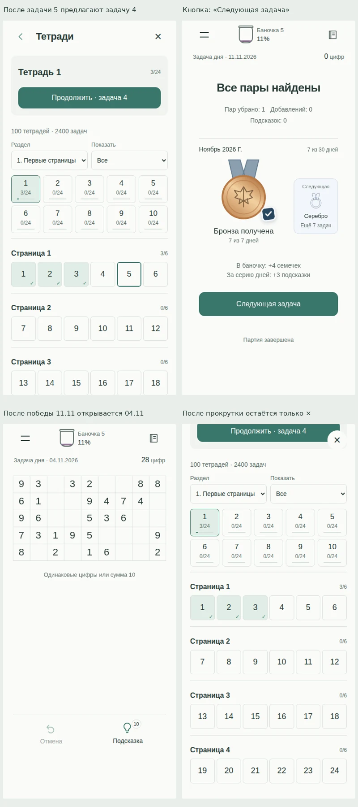
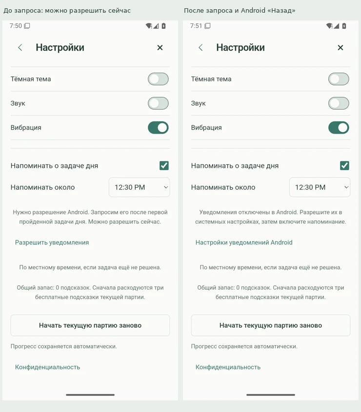
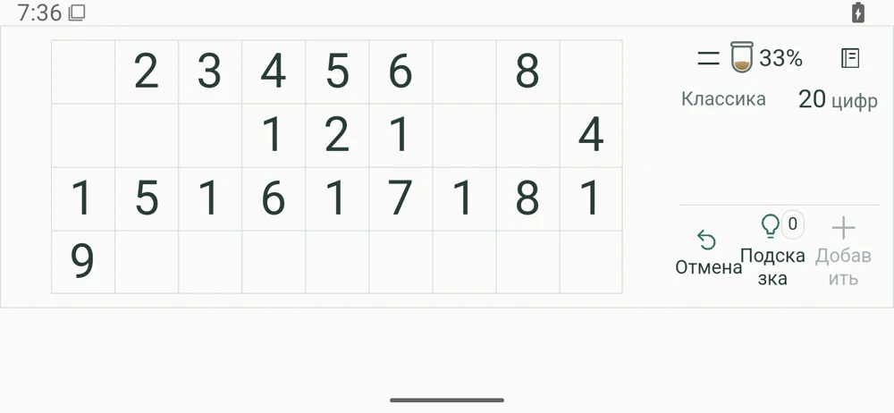

# Независимая UX-проверка «Семечек» — 11 ноября 2026

Основные игровые сценарии работают, разделы доступны, навигация в целом последовательная. Но ручной запрос разрешения на уведомления на чистой установке Android 35 оставил интерфейс в заблокированном состоянии до перезапуска. Это первая задача на исправление. Кроме неё подтверждены ошибки продолжения и первого обучения, непонятные переходы, скрытый перезапуск, бесполезное восстановление и перенос подписей внутри слов при крупном системном шрифте в горизонтали. Полная перестройка приложения из этих наблюдений не следует.

Это экспертный проход по работающему приложению с проверкой исходников и повторным воспроизведением находок. Исследование с новыми игроками и измерение их поведения не проводились. Успешное завершение автоматического сценария означает, что маршрут удалось пройти; оно не означает отсутствие UX-замечаний.

## Версия и доказательства

- Проверенные исходники: `3eb2b3cfd6c8aea3ca130f916290818fbf5ce7c5`.
- Android: реальный release payload 1.1.0 / 1100024 из [сборки 42626758548](https://github.com/DanilaH/seeds-bits/actions/runs/42626758548), runtime-коммит `e92bd4915d677caf47f74944402c82d48b483d9c`. На одноразовом эмуляторе APK подписан временным тестовым сертификатом. Код приложения для проверки не менялся.
- [Основной браузерный и Android-прогон](https://github.com/DanilaH/seeds-bits/actions/runs/42980079505).
- [Браузерные материалы](https://github.com/DanilaH/seeds-bits/actions/runs/42980079505/artifacts/13836543705): `audit.json`, `summary.json`, 223 PNG. 38 сценариев завершены; необработанных ошибок JavaScript и горизонтального переполнения страницы не обнаружено.
- [Первый Android-проход](https://github.com/DanilaH/seeds-bits/actions/runs/42980079505/artifacts/13837306601): снимки, accessibility XML, `emulator/acceptance.json`.
- [Доработанный нативный проход](https://github.com/DanilaH/seeds-bits/actions/runs/42981239219/artifacts/13837314139): дополнительная прокрутка, системный шрифт и окно выбора времени.
- [Независимый чистый запрос уведомлений и повтор горизонтали с системным шрифтом 150%](https://github.com/DanilaH/seeds-bits/actions/runs/42982179212/artifacts/13837283668): снимки до запроса, после запроса, после Android Back и после перезапуска, полный logcat и состояние разрешения пакета. Отсутствие окна и блокировка возврата повторились. Зелёный статус задания CI здесь означает, что материалы собраны: `summary.json` явно отмечает незавершённый сценарий разрешения.
- Повторяемые сценарии находятся в `scripts/ux-audit-2026-11-11.mjs`, `scripts/android-ux-2026-11-11.py` и `.github/workflows/ux-audit-20261111.yml` ветки `qa/ux-20261111`. Продуктовый код и `main` не изменены.

Для браузера проверены 320×568, 360×640, 390×844, 568×320, 844×390, 800×1280 и 1280×800, светлая и тёмная темы. Даты зафиксированы, часовой пояс — Asia/Yekaterinburg. Большая часть экранов проверена с отключённым движением для устойчивых снимков; отдельный сценарий выполнялся с анимациями и клавиатурной навигацией.

Нативные функции в браузерной матрице воспроизводились управляемыми тестовыми мостами. Подготовленные состояния позволяют добраться до медалей, ошибок хранения и исчерпанных подсказок; они не выдаются за полностью естественную историю игрока. Для продолжения тетради и тупикового поля дополнительно использовались реальные задачи и допустимые ходы через интерфейс.

Выборка подтверждённых навигационных несоответствий (подписи добавлены к неизменённым снимкам):

## Что исправить в первую очередь

Здесь P1 — блокировка пользовательского сценария, которую нужно исправить до следующего обновления; P2 — заметное препятствие или непредсказуемость обычного сценария; P3 — редкое состояние либо небольшая доработка. Приоритет не является оценкой частоты: данных аналитики для неё нет.

### UX-08 · P1 · Ручной запрос уведомлений блокирует возврат из настроек

**Воспроизведение:** чистая установка реального release payload на Android 35, разрешение `POST_NOTIFICATIONS` ещё не выдавалось. Пропустить обучение, открыть настройки, нажать «Разрешить уведомления». Системное окно с разрешением не появилось. В игре чекбокс остался включённым, а объяснение сменилось на «Уведомления отключены в Android…». Через ожидание и Android Back приложение осталось на том же экране настроек. После остановки процесса и повторного запуска главное меню снова доступно.

Поведение повторилось на отдельной чистой установке. `dumpsys package` после сценария: разрешение не выдано; флагов пользовательского отказа `USER_SET`/`USER_FIXED` нет. В полном логе не найден подтверждённый запуск системного окна запроса. Это не доказательство точной причины: проверка выполнялась на эмуляторе Android 35, офлайн, с временной CI-подписью. На других Android и физическом устройстве масштаб проблемы ещё не установлен.

**Что проверить и исправить:** прохождение реального вызова `SeedsEngagement.requestNotifications()` и его callback/reject в release-сборке. В `enableReminder()` состояние `engagementActive` блокирует возвраты, а ожидание моста не имеет ограниченного времени завершения. Нужно гарантированно освобождать управление при ошибке/незавершённом запросе и показывать точный статус; сообщение об отказе должно опираться на фактический результат. По наблюдаемому зависанию нельзя утверждать, что пользователь отказал.

**Проверка исправления:** свежая установка → ручной запрос → настоящий системный диалог → отказ/разрешение → работающий возврат в игру без перезапуска. Отдельно недоступный/неответивший мост, первый запрос после победы в дейлике, повторный запуск и Android с уже выданным разрешением. На физическом телефоне проверить также запланированное напоминание.

**Материалы:** последний нативный артефакт, `android-ux-20261111/17a-before-permission-request.png`, `17-immediate-permission.png`, `18a-native-back-after-missing-permission.png`, `18b-relaunch-after-missing-permission.png`, `permission-full-logcat.txt`, `permission-package.txt`.

### UX-01 · P2 · «Продолжить» возвращает к более ранней задаче

**Воспроизведение:** открыть задачу 4 первой тетради, убрать допустимую пару, оставить задачу незавершённой. Затем открыть задачу 5, тоже убрать пару. Нажать верхнюю кнопку тетради. Карточка предлагает «Продолжить · задача 4»; нажатие действительно открывает задачу 4, хотя активной была задача 5.

Это противоречит ожиданию продолжить только что выбранное поле. При открытии поздней задачи без ходов карточка может предлагать вообще первую нерешённую задачу.

**Причина:** `src/main.ts`, `openCollection('book')`: `continuing` берёт первую по порядку незавершённую задачу с историей, затем первую нерешённую. `progress.active` не получает приоритета.

**Решение:** в выбранной тетради сначала предлагать активную незавершённую задачу, включая задачу без ходов. Остальные начатые задачи использовать как запасной вариант. Текст и фактическое назначение кнопки должны совпадать.

**Проверка исправления:** две незавершённые задачи → возврат из второй → продолжение второй; повторить после перезапуска, с задачей без ходов и после завершения текущей задачи.

**Материалы:** `book-resume-two-unfinished--resume-priority.png`, `book-resume-two-unfinished--actual-resumed-game.png`; `audit.json → observations → book-resume-two-unfinished`.

### UX-02 · P2 · После ухода из первого обучения оно начинается снова

**Воспроизведение:** на чистом запуске в коротком обучении нажать верхнюю кнопку тетради, начать задачу 1, затем перезапустить приложение/страницу. Снова показывается первый шаг обучения, хотя пользователь уже осознанно выбрал другой режим.

**Причина:** `switchGame()` завершает текущий показ урока через `lesson = -1`, но не записывает завершение или пропуск первого обучения. `boot()` снова проверяет `settings.tutorialDone` и запускает урок.

**Решение:** явный выбор режима из первого обучения считать выходом из обязательного первого показа. Сохранить выбранную задачу, а обучение оставить доступным через «Как играть».

**Проверка исправления:** чистый запуск → переход в тетрадь/другой режим → ход → перезапуск → продолжение выбранного поля без принудительного урока. Повторный запуск «Как играть» из меню должен работать.

**Материалы:** `fresh-leave-tutorial-via-notebook--book-during-tutorial.png`, `--book-game.png`, `--after-reload.png`.

### UX-03 · P2 · «Следующая задача» незаметно ведёт в архив

**Воспроизведение:** завершить сегодняшнюю задачу 11.11.2026 при уже решённых 5–10 ноября. Нажать «Следующая задача». Открывается задача **04.11.2026**.

Архив сам по себе полезен, но подпись не объясняет, что следующая игра относится к прошлому. Можно принять её за продолжение сегодняшнего испытания и ожидать увеличения серии дней. Дата в небольшой строке над полем даёт недостаточно заметное предупреждение.

**Причина:** `src/puzzles.ts`, `nextTask()` после поиска вперёд перебирает нерешённые прошлые дни; `src/main.ts`, `renderWin()` сохраняет общую подпись «Следующая задача».

**Решение:** для такого назначения писать «Задача из архива» и показывать выбранную дату; оставить доступ к календарю. Архив должен явно отличаться от сегодняшней задачи и её серии.

**Проверка исправления:** сегодняшняя победа, победа в архиве, все дни текущего месяца решены, весь доступный архив решён. Название кнопки и дата назначения должны оставаться точными.

**Материалы:** `daily-next-destination--result.png`, `daily-next-destination--destination.png`; соответствующее наблюдение в `audit.json`.

### UX-04 · P2 · «Назад» уезжает при прокрутке, а крестик остаётся

**Воспроизведение:** открыть тетради или календарь и прокрутить вниз. Заголовок и стрелка «Назад» исчезают выше экрана. Крестик остаётся закреплён, но закрывает меню целиком, возвращая в игру вместо предыдущего раздела.

На телефоне 390×844 внизу тетради у крестика координата `y=14`, у стрелки `y=-144`; в календаре стрелка уходит ещё выше. Системный Back/Escape работает; проблема именно в доступном действии на экране.

**Решение:** единая закреплённая шапка «Назад — заголовок — закрыть», с зарезервированным местом над содержимым. Существующую историю экранов и восстановление прокрутки сохранить.

**Проверка исправления:** тетради, календарь, длинная коллекция, настройки с крупным шрифтом; портрет и короткая горизонталь. Заголовок и обе навигационные кнопки доступны и не перекрывают задачи.

**Материалы:** `deep-screen-header-reachability--book-bottom.png`, `phone390--calendar-bottom.png`; измерения `deep-screen-header-reachability` в `audit.json`.

### UX-05 · P2 · Перезапуск партии спрятан в настройках

**Маршрут:** поле → меню → настройки → «Начать текущую партию заново» → подтверждение. Перезапуск находится среди темы, звука, уведомлений и конфиденциальности. В обычном меню текущей партии его нет; отдельное предложение появляется лишь в некоторых тупиковых состояниях.

Это частое игровое действие, которое сложно найти по смыслу раздела. Само подтверждение работает корректно и защищает от случайного сброса.

**Решение:** поставить перезапуск в меню текущей партии рядом с продолжением, сохранив подтверждение. Ещё одна постоянная кнопка на игровом поле для этого не требуется.

**Проверка исправления:** классика, тетрадь, дейлик, завершённая партия; отмена подтверждения сохраняет поле, историю и текущий экран.

**Материалы:** `phone390--settings.png`, `restart-confirmation--confirm.png`, `restart-confirmation--cancel-return.png`.

### UX-06 · P3 · Предлагается восстановить заведомо повреждённую копию

**Воспроизведение:** запустить приложение с неразбираемым JSON сохранения. Исходные данные корректно сохраняются в `.recovery`, открывается новая партия и предлагается «Восстановить резервную копию». Нажатие закономерно завершается ошибкой чтения. Кнопка снова активна и повторяет ту же ошибку сколько угодно раз.

Потери данных в этом сценарии не обнаружено. Проблема в обещании ремонта: сохранённый повреждённый исходник представлен пользователю как пригодная резервная копия.

**Решение:** проверять пригодность копии до предложения восстановления. Повреждённый исходник сохранить для разбора, но не выдавать за рабочий бэкап. После известной ошибки не предлагать тот же бесполезный повтор.

**Проверка исправления:** повреждённый JSON, частично восстановимое сохранение, пригодная старая копия, формат из будущей версии. Исправные данные и исходники не должны затираться; доступность кнопки должна соответствовать возможности восстановления.

**Материалы:** `invalid-backup-action--offered-backup.png`, `--restore-failed.png`, `--repeat-restore.png`.

### UX-07 · P2 · Крупный системный шрифт ломает подписи в горизонтали

**Воспроизведение:** Android 35, системный размер шрифта 150%, телефон 780×1688 px с density 320; повернуть в горизонталь и открыть классику. В правой колонке «Подсказка» переносится как «Подска / зка», «Добавить» — как «Добав / ить». Это снимок настоящего release payload, а не CSS-эмуляция крупного текста.

Кнопки доступны и продолжают работать, но подписи приходится собирать из частей. В обычном размере шрифта и в проверенном портрете такого разрыва нет.

**Решение:** при увеличенном тексте дать действиям больше места: расширять колонку либо перестраивать действия в вертикальный список. Не уменьшать выбранный пользователем системный шрифт и не отнимать зарезервированное место баннера.

**Проверка исправления:** реальные системные 100%/150%, портрет/горизонталь, счётчики 0/3/99, доступная и недоступная реклама. Подпись и счётчик помещаются без разрыва слова и перекрытия соседней кнопки.

**Материалы:** первый Android-артефакт, `android-ux-20261111/15-game-landscape-font150.png`.

## Небольшие доработки

- **Планшет в портрете:** на 800×1280 двухколоночное меню растягивает карточки и оставляет большой разрыв между логотипом и действиями. Карточки режимов начинаются около `y=388`, основная кнопка — около `y=804`. Всё доступно, но композиция менее собранная, чем на телефоне. Стоит пересмотреть именно этот брейкпоинт, не заполняя экран лишними элементами. Материал: `tabletPortrait--home.png`.
- **Подписи состояний:** в результате встречается «В баночку: +4 семечек» вместо «+4 семечки». У завершённой партии над карточкой может остаться «Текущая партия», хотя кнопка уже корректно предлагает результат. Исправить склонение и согласовать статус карточки с её действием.
- **Уведомления:** тема, звук и вибрация оформлены переключателями, напоминание — маленьким стандартным чекбоксом. Кликабельная подпись расширяет его область, поэтому размер самого квадратика не означает недоступность. Унификация оформления и явные состояния «нужно разрешение / включено / отключено Android» сделают настройку понятнее.
- **Самые узкие телефоны:** на ширине 320 CSS px игровая клетка около 30.7×30.7 px, на 390 — 38.4×38.4. Переполнения нет, но мелкие клетки требуют более точного попадания. Это ограничение девятиколоночного поля, которое стоит отдельно оценить пальцем на небольшом реальном устройстве; автоматический клик не доказывает удобство попадания.

## Что работает и что стоит сохранить

| Область | Наблюдение |
| --- | --- |
| Первый запуск | Короткое обучение из двух шагов и отдельное полное обучение проходят; инструкция требует сделать понятное действие на маленьком поле. |
| Поле | Выбор пары, неверная пара, отмена, добавление чисел и подсказка дают обратную связь; управление остаётся доступным в проверенных ориентациях. |
| Большие тетради | Тетрадь 100, задача 24: поле на 536 цифр прокручивается; подсказка приводит к нужной паре без превращения всех цифр в мелкий текст. |
| Каталог тетрадей | Фильтры, разделы, состояния завершения и сообщение при пустом фильтре доступны; есть сброс фильтра. |
| Календарь | Можно выбрать год и месяц и добраться до января 2025 без десятков нажатий стрелки; есть переход к сегодняшней задаче. |
| Коллекция | Цепочка «Прогресс → Коллекция → месяц → назад» возвращает в ожидаемые разделы и сохраняет контекст. |
| Медали и итог | Бронза, серебро, золото, следующая цель и награды отображаются; завершённое поле не оставляет активные игровые действия отмены и подсказки. |
| Тупик | В реальной задаче 7 после допустимых пар `[2,22]`, `[7,25]`, `[9,10]` подсказка объясняет отсутствие решения и предлагает вернуться к решаемому полю. Возврат восстанавливает рабочую позицию. |
| Подсказки и видео | После исчерпания бесплатных подсказок видео предлагается явно; недоступность возвращает к игре и не выдаёт фиктивную награду. |
| Ошибки сохранения | Предупреждение и повтор сохранения доступны из игры и меню; успешный повтор убирает сообщение. Более новый формат защищён от перезаписи. |
| Android | В реальном release payload прошли офлайн-запуск, пропуск обучения, ход, отмена, учёт подсказок, возврат из недоступной рекламы, сохранение поля и баланса после остановки процесса, поворот и открытие конфиденциальности. |

## Системный шрифт и нативные окна

Первичная браузерная матрица с `html { font-size:150% }` не увеличивала большинство элементов с фиксированными пиксельными размерами. Поэтому она не считается доказательством поддержки системного крупного текста. Дополнительно сделан эксперимент с реальным увеличением вычисленных размеров шрифта каждого элемента и отдельный Android-проход с системным `font_scale=1.5`.

CSS-эксперимент действительно даёт перенос подписи подсказки и заголовка настроек, но это искусственное стресс-состояние. На полученных нативных портретных снимках с системным шрифтом 150% подпись подсказки остаётся в строке, поле читаемо. Нижние ссылки главного меню уходят под прокрутку, что само по себе не является блокировкой доступа.

После повторного прохода по снимкам подтверждены нативные тетради с прокруткой и настоящее системное окно выбора времени напоминания. Важное ограничение: кадр повторного сценария `12-settings-font150` фактически показывает календарь, поэтому статус `completed` этого сценария не засчитан как проверка настроек в портрете с крупным шрифтом. Обычные настройки и настройки в горизонтали с крупным шрифтом доступны. Автоматические маршруты сверялись со снимками, а не принимались по одному зелёному статусу.

Путь ручного запроса уведомлений повторён отдельно на чистых данных с полным журналом и проверкой возврата. Он не завершён успешно и вынесен в UX-08. Результат интерфейса при выданном/отклонённом разрешении в браузере проверен с тестовым мостом; это не заменяет исправление реального системного запроса.

## Порядок доработки и границы вывода

1. Установить причину незавершённого нативного запроса уведомлений и гарантировать разблокировку интерфейса. Подтвердить настоящий системный диалог на эмуляторе и телефоне.
2. Исправить приоритет продолжения задачи и фиксацию выхода из первого обучения. Это предотвращает потерю контекста возвращающегося и нового игрока.
3. Уточнить переход в архив и закрепить экранную кнопку «Назад» вместе с заголовком.
4. Перенести перезапуск в меню партии; оставить существующее подтверждение. Исправить подписи действий в горизонтали с крупным системным шрифтом.
5. Убрать ложное предложение восстановить непригодный бэкап, затем поправить подписи и планшетный брейкпоинт.
6. Повторить именно затронутые маршруты в браузере и Android, включая системный шрифт 150%, поворот, отмену действия и перезапуск приложения.

Основная игра прошла проверенные маршруты, но путь включения уведомлений нельзя считать готовым из-за UX-08. Проверка не подтверждает работоспособность любого устройства и любой истории сохранений. Живая выдача рекламы, атрибуция VK/AppMetrica, доставка уведомления по расписанию и настоящий диалог оценки RuStore здесь не проверялись: нативный прогон был офлайн. Звук, приятность вибрации и удобство попадания пальцем требуют проверки на физическом телефоне. Длительное поведение анимаций и их субъективный feel не выводятся из статических снимков.
