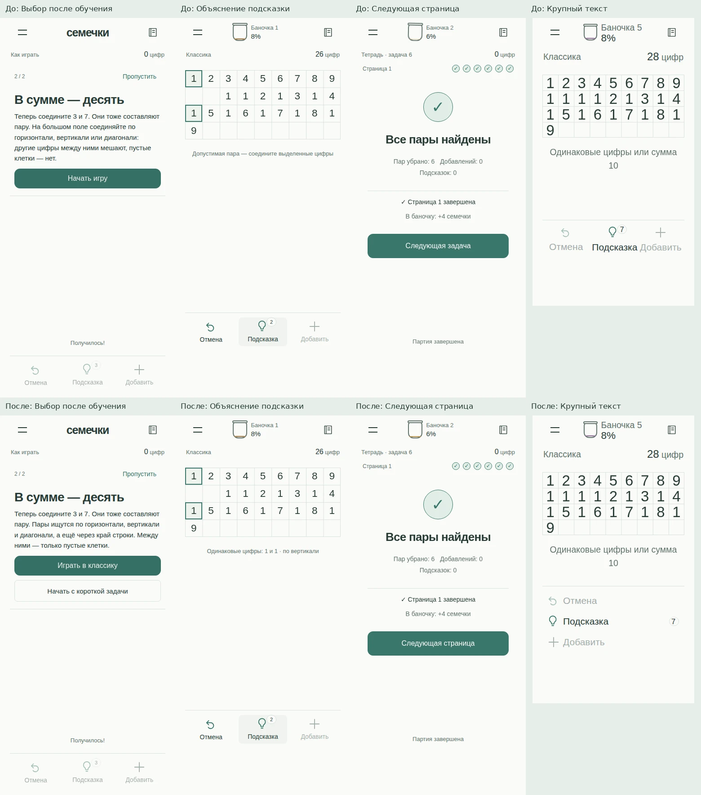
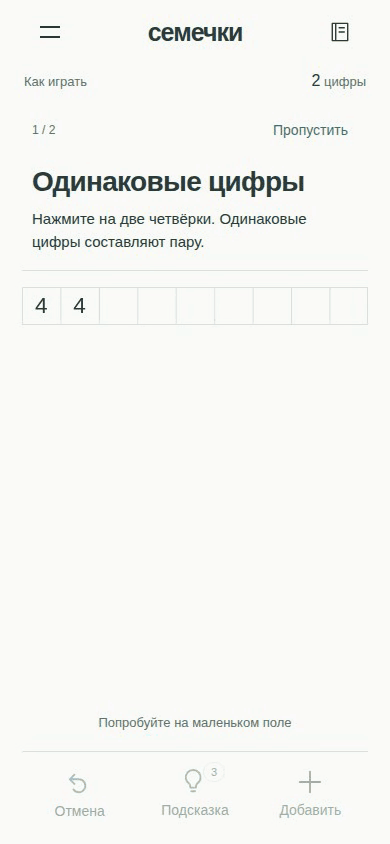
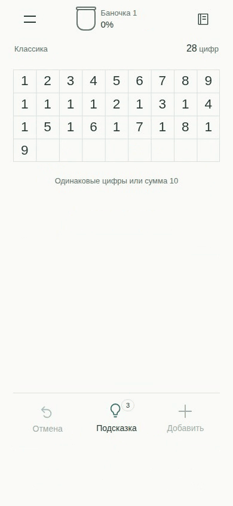
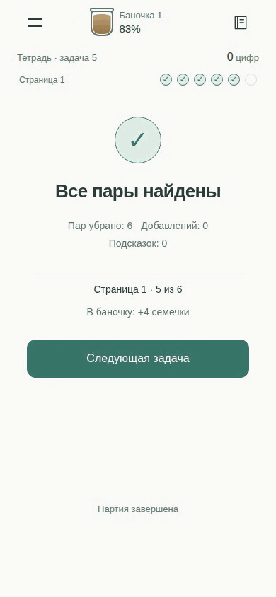

# Материалы независимой проверки

[Аудит и причины правок](../PRODUCT_AUDIT_2026-11-11.md) · [handoff](HANDOFF.md) · [результаты проверок](acceptance.json).

Это реальные кадры приложения и записи автоматических UI-сценариев с известными решениями. Это **не человеческий плейтест**. Баннеры/permissions/analytics в браузере заменены управляемыми мостами. Поздние состояния коллекции и сложные поля в обзорной матрице задаются fixtures; последовательное прохождение первой страницы начинается с чистого контекста.

## До и после

| Изменение | До | После |
|---|---|---|
| Выбор после обучения и правило через край строки | [Кадр](media/before-lesson-2.png) | [Кадр](media/after-lesson-2.png) |
| Объяснение показанной пары | [Кадр](media/before-hint.png) | [Кадр](media/after-hint.png) |
| Явный переход к следующей странице | [Кадр](media/before-complete-6.png) | [Кадр](media/after-complete-6.png) |
| Реальное увеличение всех шрифтов на 150%, 360×640 | [Кадр](media/before-large-text.png) | [Кадр](media/after-large-text.png) |

Первые три исходных кадра — runtime `54a18e0`, запись `84b247a`. Исходный кадр крупного текста — `56d0c77`, код игры которого совпадает с baseline. Матрица после, запись с полным временем анимаций и нативный APK — один исходник `160da8c`. Полные SHA — в [media.json](media.json) и [source-proof.json](source-proof.json).

## Записи взаимодействий

Темп проигрывания 1×; GIF преобразованы из WebM в 12 fps. Паузы на результате сделаны **в сценарии записи**, чтобы успевали завершиться перелёт семечек и заполнение банки. Само приложение для записи не ускорялось и не замедлялось.

**Вход в короткую задачу после двух шагов обучения:**

**Подсказка объясняет пару; после выбора цифр меняется поле и пополняется банка:**

**Последние пары страницы, полная банка и следующая страница:**

## Остальные экраны

| Экран | Проверенный кадр |
|---|---|
| Главное меню | [Кадр](media/checked-phone390-home.png) |
| Тетради | [Кадр](media/checked-phone390-books.png) |
| Календарь | [Кадр](media/checked-phone390-calendar.png) |
| Прогресс | [Кадр](media/checked-phone390-progress.png) |
| Баночки | [Кадр](media/checked-phone390-jars.png) |
| Медали | [Кадр](media/checked-phone390-medals.png) |
| Настройки | [Кадр](media/checked-phone390-settings.png) |
| О данных | [Кадр](media/checked-phone390-privacy.png) |
| Короткий landscape | [Кадр](media/checked-landscape568-classic.png) |
| Увеличенный текст в landscape | [Кадр](media/checked-largeTextLandscape-classic.png) |
| Длинное поле | [Кадр](media/checked-book-filters-and-large-field-large-bottom.png) |
| Результат с медалью | [Кадр](media/checked-daily-result-bronze-result.png) |

Все 221 кадр матрицы и 72 кадра последовательных сценариев хранятся также в CI-артефактах, ссылки — в handoff. Здесь закреплены выбранные исходные PNG и GIF; материалы из `docs/` не входят в APK.

## Ошибка QA, которую нельзя скрывать

[Ранний нативный кадр с настоящей рекламой](evidence/early-native-network-enabled.png) — **свидетельство ошибки изоляции, не магазинный скриншот и не офлайновая приёмка**. В раннем этапе UX была доступна сеть. Его данные нужно отделить от игроков: [номера сборок и точные оговорки](analytics-quarantine.json). Первоначальные native-попытки остановились на DNS Ubuntu до приложения. Финальная приёмка точного APK 1102015 затем прошла с автономно собранным OCR и host firewall до boot: run 43042330546. История ошибок сохранена в handoff.

## Воспроизведение

`npm test`, `npm run build`, `npm run test:e2e`; дополнительные model/integration и Android-команды перечислены в `.github/workflows/product-audit.yml`. Полные записи: `node scripts/product-journey.mjs` при установленном Playwright browser/ffmpeg. Извлечение выбранных PNG/GIF: `python3 scripts/product-audit-media.py --help` (Pillow и ffmpeg). Нативная изоляция — Linux CI helper `scripts/ci-offline-emulator.sh`; он не предназначен для телефона игрока.

## Предыдущая проверенная Android-сборка

Runtime `c3b4ebf`, изолированный прогон [43029903310](https://github.com/DanilaH/seeds-bits/actions/runs/43029903310), без live-рекламы. Это предыдущий кандидат, не финальная APK-приёмка `160da8c`.

[Портрет, текст 150%](evidence/previous-native-portrait.png) · [Горизонтально, текст 150%](evidence/previous-native-landscape.png).

## Финальный Android APK 1102015

[Успешная приёмка 43042330546](https://github.com/DanilaH/seeds-bits/actions/runs/43042330546), test source `b51a505`, artifact `13866676858`. Игра — тот же runtime `160da8c`; PNG ниже сохранены непосредственно с Android. Release payload подписан временным CI-сертификатом, внешняя сеть заблокирована до boot. Физический телефон и live-реклама этим не проверены.

| Кадр | Оригинал |
|---|---|
| Портрет, системный текст 150% | [PNG](media/native-portrait-150.png) |
| Горизонтально, боковые действия после прокрутки | [PNG](media/native-landscape-150-scroll.png) |
| Настоящий Android permission dialog | [PNG](media/native-notification-permission.png) |
| Native time picker | [PNG](media/native-time-picker.png) |
| Offline rewarded: отказ без выдачи подсказок | [PNG](media/native-offline-rewarded.png) |
| Восстановление после обновления | [PNG](media/native-upgrade.png) |

Владельцу выдан APK для телефона; [порядок приёмки](PHONE_CHECK.md), [проверка подписи/ресурсов](evidence/phone-apk.json). Наблюдения новых игроков и серверные события AppMetrica ещё не получены.
