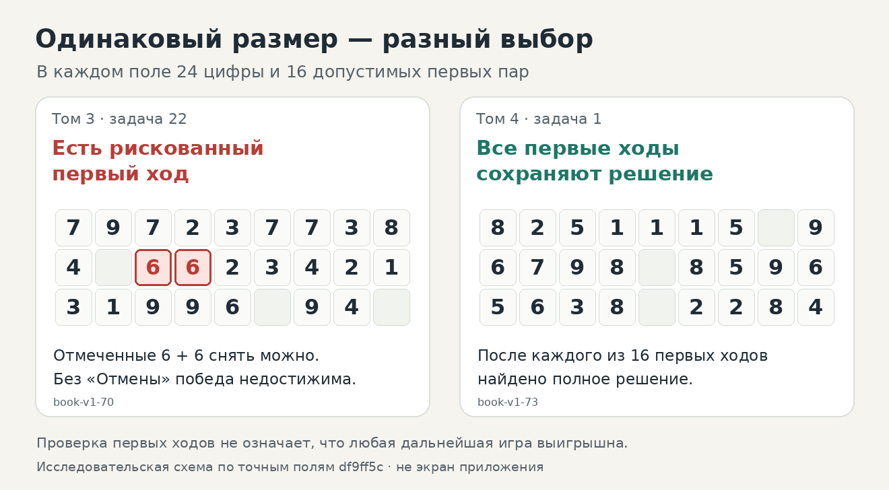

# Дейлики и тетради: расширение через разные игровые ситуации

**24 ноября 2026 · «Семечки» · исследовательское предложение, не реализация.** Проверенная продуктовая база — [PR #9, df9ff5c](https://github.com/DanilaH/seeds-bits/tree/df9ff5c3df8b017803e2ff924c2812a5efc530ac). Документ продолжает [аудит генератора](../generator-audit-2026-11-23/FOLLOWUP_12082.md) и [базовый разбор режимов](../daily-notebook-baseline-2026-11-23/README.md). Изменены только исследовательские документы и их воспроизведения.

## Рекомендация

**Первый выпуск — две тематические тетради по 24 новые задачи и 28 новых ежедневных задач.** Тетради дают последовательное освоение и сочетание приёмов, дейлики — короткое ежедневное изменение характера задачи. Это предлагаемая первая порция, не окончательный предел каталога и не уже утверждённый владельцем объём релиза.

В основе — пять разных ситуаций на действующих правилах:

| Ситуация | Что происходит у игрока | Чем разнообразить |
|---|---|---|
| Спокойная зачистка | Несколько понятных снятий, уверенное продвижение | Расположение групп, направления и короткие связки |
| Новые связи | Снятая пара открывает ранее недоступную | Место раскрытия, два последовательных открытия, выбор полезного открытия |
| Край строки | Игрок замечает связь по существующему порядку чтения | Разные места перехода; сочетание с освобождённым промежутком |
| Поле меняется | После удаления пустой строки меняются связи оставшихся цифр | Полезный сдвиг, исчезновение прежней связи, подготовка следующего снятия |
| Порядок имеет значение | Законные действия имеют разные последствия | Развилка после простого входа, сравнение планов; проигрышная ветка не обязательна |

Названия — редакторские описания нашей адаптации. Они не вводят новых правил. Ведущий приём описывает задачу, а не гарантирует, что любой игрок пройдёт её одним путём. Более крупное поле означает больший объём; трудность выбора оценивается отдельно.

## Почему можно начинать сейчас

В существующем каталоге найдены **336 коротких задач** с 8–32 цифрами и не более 54 логических клеток. Все 336 записанных путей воспроизведены через точное ядро игры. В 169 задачах есть снятие, открывающее минимум две новые связи без сжатия; в 96 — связь, возникающая именно из-за удаления строки. Признаки относятся к одному проверенному пути и пересекаются. [Измерения тетрадей](notebook/README.md#1-что-измерено).

Особенно показательно сравнение двух уже существующих задач:

**book70 и book73: по 24 цифры, 27 клеток и 16 первых пар.** В book70 снятие отмеченных 6+6 законно, но из полученного состояния полная очистка последующими снятиями невозможна; «Отмена» возвращает в разрешимое состояние. Для остальных 15 первых ходов найдены решения. В book73 продолжения найдены после всех 16 первых ходов. Проверка начальных альтернатив не гарантирует безопасность любого дальнейшего выбора. [Поля, ветки и пути](notebook/data/fixtures.json).

На 11 задачах тетрадей проверены 33 состояния и 208 ближайших альтернатив: 205 FOUND, 3 NO_WIN_PROVEN, 0 UNKNOWN. Для ежедневок воспроизведены все 365 путей календарного 2026 года; отдельно на шести задачах — 18 состояний и 195 альтернатив: 193 FOUND, 2 NO_WIN_PROVEN, 0 UNKNOWN. Это ограниченные исследования исходного кода с бюджетом 5000 на один вызов поиска. Не измерения игроков и не проверка всех достижимых состояний всего каталога. [Дейлики и границы вывода](daily/README.md#что-проверено).

**Практическое следствие:** технический принцип получения таких задач уже существует. Следующая работа — создавать новые сочетания, отбирать их по фактическому устройству и складывать в осмысленные последовательности. Не требуется сначала переавторить 2400 прежних задач.

## Две тетради

| Тетрадь | Страница 1 | Страница 2 | Страница 3 | Страница 4 |
|---|---|---|---|---|
| **Новые связи** | Освобождаем линии | Замечаем край строки | Чередуем приёмы и короткую передышку | Соединяем приёмы в небольшой комбинации |
| **Поле меняется** | Видим эффект сжатия | Меняем место и роль сжатия | Сравниваем порядок снятия | Собираем раскрытие, край и сжатие |

Каждая страница содержит шесть задач. Предлагаемый стартовый диапазон — 12–32 цифры, до 54 логических клеток. Внутри страницы: понятный вход, варианты в другом контексте, короткий контраст, сочетание знакомого. Увеличивать поле на каждом шаге не нужно. Оба сборника доступны для свободного выбора, как текущие тетради; уже начатая задача продолжает открываться с прежнего места.

Подготовлены **48 разных старых эталонов** для восьми страниц. Они помогают разработчику понять постановки и проверить авторинг. **Это не 48 новых полей.** QA-подборка использует старый ID, done и то же право однократной награды; незавершённая сессия продолжается, решённую задачу можно переиграть нынешним способом без повторной выплаты. [Точная подборка](notebook/data/pilot-reference-sets.json).

## Дейлики

У дейлика остаются привычные «Сегодня», архив, серия и месячный трофей. Разнообразие приходит в само поле. Пример семи ролей: **спокойная зачистка → раскрытие → край → передышка → порядок → сочетание → сжатие**. Это пример последовательности, а не вечный закон «по пятницам сложнее».

Семь старых полей одного объёма — по 24 цифры — уже подобраны как исследовательский контроль. В них различаются реальные эпизоды, включая раскрытие, сжатие и выбор в середине партии. Их исходные календарные даты не переназначаются. [Неделя и точные сценарии](daily/README.md#2-неделя-постоянного-объёма-для-первой-проверки).

Для нового банка предлагаются четыре недели / 28 полей. Первые семь новых полей — по 24 цифры, чтобы отдельно увидеть различия устройства. Для следующих 21 — предложенная волна объёма 16/24/24/16/24/32/24, с изменением порядка ведущих приёмов между неделями. Это редакторская гипотеза для первой версии; телефонная проверка может поменять конкретные размеры и порядок до фиксации банка. Авторинг и совместимость можно делать уже сейчас.

## Что передаётся разработчику

1. [DEVELOPER_SPEC.md](DEVELOPER_SPEC.md) — состав 76 новых задач, конкретные before/action/after, отбор, экранный сценарий и критерии приёмки.
2. [COMPATIBILITY.md](COMPATIBILITY.md) — неизменность старых задач, новые ID, формат сохранения, назначение даты, продолжение офлайн и единственная награда за день.
3. [DESIGN_FEATURES.json](DESIGN_FEATURES.json) — стабильные локальные идентификаторы, очередность и условия возврата к следующим этапам.
4. [notebook](notebook/README.md), [daily](daily/README.md), [references](references/README.md) — данные, воспроизведения и точные границы заимствуемых идей.

Цена первого выпуска: **средняя**. Профилирование и эталоны уже готовы; новые поля требуют авторинга, а совместимость — аккуратной работы с ID и календарём. Свободный бесконечный генератор с новым общим директором существенно увеличит объём разработки; для этого банка достаточно офлайн-конструктора и фиксированных записей.

Следом можно расширять цепочки раскрытий, сочетания двух приёмов, отдельные тетради по краю/порядку и авторские тематические недели. Большие необязательные задачи остаются возможным отдельным форматом. Эти направления отложены до получения первого законченного банка, а не исключены владельцем.

## Источники и уровень уверенности

Из наших исследований берём разделение длины и характера решения в Crossmath, редакторскую последовательность страниц из проекта Hue и вывод Blocky о необходимости новых конструкций при исчерпании старого набора. Это перенос наших проверяемых принципов; доказательств эффекта на аудиторию «Семечек» пока нет. [Точные документы и границы утверждений](references/README.md).

По **Number Match Easybrain, ежедневный режим**, подтверждён ресурсный текст о месячном кубке. Он не раскрывает недельный алгоритм сложности. По **Number Match NADO** устройство ежедневок и кампании остаётся UNKNOWN. **Number Tiles Easybrain** остаётся отдельным референсом помощи/экономики и не используется здесь как доказательство календарного дизайна. Новых APK или игровых сеансов оригиналов в этой работе не было; исходные 36 sourceFeatureId не меняются.

Интересность, узнаваемость тем, длительность, комфорт на физическом телефоне и семечки в минуту — UNKNOWN с конкретными проверками в ТЗ. Технические данные достаточны, чтобы сделать обозримый первый выпуск; они не обещают удержание или подтверждённый человеческий баланс.

**KIT IMPACT — REUSE / CANDIDATE.** Переиспользованы разделение объёма и выбора, постоянные ID клеток и честные исходы bounded search. Кандидат на перенос в общий кит после реализации: проверка назначения нового контента без замены старых ID и дат. Это пока потребительское ТЗ, не доказанный универсальный модуль.
