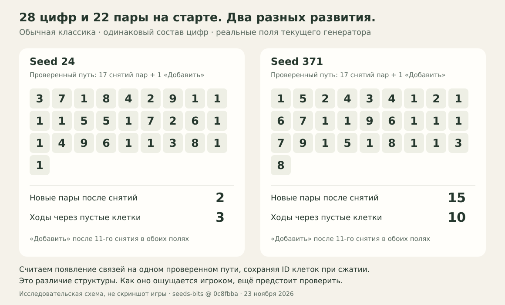

# Проверка выдачи на фактических правилах «Семечек»

**23 ноября 2026 · исследование для №13/№14 · продолжение PR №15.**

## Решение по результатам

**Разделение объёма и структуры подтверждено на собственных полях.** Уже внутри Обычной классики можно получить разные продолжения при одинаковых 28 цифрах, составе, стартовом числе пар и даже длине найденного решения. Это достаточное основание добавить описание развития поля в исследовательский отбор. Человеческая различимость четырёх сложностей остаётся открытой.

**Исторический конструктор полезен как задел, но перенос на 45/81 не готов.** Два плотных поля на 45 цифр имеют полные проверенные решения. Оба относятся к одной конструкции: снятие пар → остаток из пяти цифр → одно добавление. Плотного поля на 81 цифру в заранее ограниченном поиске не найдено. Эти результаты не подтверждают готовность четырёх ступеней и не доказывают невозможность 81.

**Приоритет разработчику:** сначала корректный измеритель и воспроизводимые контрастные поля; затем отдельный способ надёжно получать плотные 45/81; после этого отбор и чередование. Настройка весов сама по себе не исправляет нехватку конструкций.

## 1. Источник, режим и уровень проверки

Все новые результаты ниже относятся к **нашей игре Seeds / обычной классике**, либо к явно обозначенному историческому каталогу и исследовательским кандидатам. Это не новые наблюдения Easybrain Number Match, NADO Number Match или Number Tiles.

- Рабочая ветка PR №9: `research/seeds-first-session-20261120`, **0c8fbba9c8864f39a398c5a6517b7b493ae3b1fc**. Перед запуском и перед сохранением исследования head не изменился. На этой ревизии действуют три размера: **18 / 28 / 27**.
- Исследовательская база PR №15 перед этой проверкой: `bc005c2ad68745d5858e0bd9840ca1896d6fa9be`. Игровые файлы совпадают с указанной рабочей ревизией.
- Kit main: `5cac32b0851c80bdff1d61069b8524b9e42170e1`; используются Reference Protocol, Porting Framework и Playability Choice Evidence Ladder, перечисленные в [основном исследовании](../README.md).
- [Точные источники и Git blob/SHA256](snapshot-manifest.json). Границы правил: [core.ts](https://github.com/DanilaH/seeds-bits/blob/0c8fbba9c8864f39a398c5a6517b7b493ae3b1fc/src/core.ts), функции `checkPair`, `pairs`, `removePair`, `addNumbers`. Границы генерации: [classic-generator.ts](https://github.com/DanilaH/seeds-bits/blob/0c8fbba9c8864f39a398c5a6517b7b493ae3b1fc/src/classic-generator.ts), `generateClassic`, `solveClassic`, проверка сохранённого состояния.

| Часть | Что именно выполнено | Уровень доказательства |
|---|---|---|
| Baseline и три политики выбора | Node v24.22.3 исполняет точные TS-файлы продукта после удаления типов; меняется только разрешение импорта | **ACTUAL_PRODUCT_TS_EXECUTION** |
| Ветки и геометрические контрпримеры | Фактический core/solver; отдельно малый независимый исчерпывающий oracle | **PRODUCT_EXECUTION + RESEARCH_ORACLE** |
| Кандидаты 45/81 | Исследовательская реконструкция исторического конструктора с явно указанными вариантами; все сертификаты проверены actual core | **MODEL_EXECUTION_OFFLINE_RESEARCH** |
| Сложность для человека, скорость Android, работа UI | В этот проход не измерялись | **UNKNOWN** |
| Поведение оригинальных APK и живой аудитории | В этот проход не наблюдалось | **NOT_OBSERVED** |

Число добавлений в сертификате означает число в **найденном пути**, а не доказанный минимум. Два Add в прогонах стратегий и ответвлений — **предел аудита**, не новый лимит обычной игры. `UNKNOWN` после ограниченного поиска не называется тупиком.

## 2. Baseline воспроизвёл предыдущий аудит

По 1000 свежих запусков каждого уровня, seeds `0..999`, пустая история `recent`. Проверены все возвращённые сертификаты, условия Add и точный результат сжатия строк.

| Показатель | Лёгкая 18 | Обычная 28 | Высокая 27 |
|---|---:|---:|---:|
| Полей / полных проверенных решений | 1000 / 1000 | 1000 / 1000 | 1000 / 1000 |
| Медиана стартовых пар | 13 | 22 | 16 |
| Найденных решений с 0 / 1 / 2 Add | 1000 / 0 / 0 | 175 / 339 / 486 | 0 / 439 / 561 |
| Очисток стратегией «первая допустимая пара», до 2 Add | 1000 | 714 | 584 |
| Fallback в выборке | 0 | 0 | 0 |
| Медиана снятий пар в найденном решении | 9 | 18 | 19 |

Все перечисленные показатели совпали с независимой моделью предыдущего №14. Дополнительно **128/128** сохранённых legacy-сертификатов очистили поле; измерения из старого `content.json` воспроизведены без расхождений. В этой проверке подтверждены 47 151 снятие и 2872 Add generated-сертификатов, ещё 2122 снятия и 32 Add legacy-сертификатов. [Данные](baseline-summary.json) · [скрипт](baseline-audit.mjs).

Ноль fallback в этой выборке не доказывает нулевую вероятность fallback. Свежий `newClassicRun(seed)` также не проверяет сохранение и длинную историю партий.

### Что добавилось к прежним метрикам

| Медиана по одному найденному решению | Лёгкая 18 | Обычная 28 | Высокая 27 |
|---|---:|---:|---:|
| Снятий через хотя бы одну промежуточную пустую клетку | 3 | 7 | 8 |
| Событий появления новых пар после снятия и сжатия | 3 | 8 | 9 |
| Максимальная серия ходов с единственной легальной парой | 1 | 2 | 2 |
| Полей, где сжатие меняло связи между оставшимися числами | 0/1000 | 406/1000 | 465/1000 |

Новые пары сравниваются по **стабильным ID цифр**. После Add копии получают новые ID. Сравнение состояния после обнуления выбранных цифр и после удаления пустых строк отдельно выделяет вклад сжатия. Считаются события появления, поэтому одна связь может учитываться повторно, если исчезла и возникла снова.

Найдено методическое расхождение названий: старый `gapMoves` также считает некоторые соседние переходы через край строки без промежуточной пустой клетки. Это **37/128 legacy-полей и 47 ходов**. Старое значение сохранено для сопоставимости; добавлена отдельная `throughEmptyCellsMoves`. Это уточнение исследовательской метрики, не ошибка правил игры. [Определения и результаты](baseline-summary.json).

## 3. Контролируемые примеры: равный объём, разное развитие

Во всех примерах таблицы совпадают **28 занятых клеток, точный состав цифр и 22 стартовые пары**. Состав Обычной — двенадцать единиц и по две цифры от 2 до 9.

| Seeds | Дополнительное совпадение | Наблюдаемое различие |
|---|---|---|
| **24 / 371** | В обоих решениях 17 снятий и 1 Add после 11-го снятия; простая стратегия выигрывает в обоих | Новых пар после снятий **2 / 15**; ходов через пустоты **3 / 10** |
| **8 / 272** | В обоих решениях 27 снятий и 2 Add | Одна и та же стратегия очищает первое поле; на втором после 2 Add остаются 8 цифр. Оба имеют полное решение |
| **290 / 371** | В обоих решениях 17 снятий и 1 Add; простая стратегия выигрывает в обоих | Ходов через пустоты **2 / 10** |
| **128 / 811** | Совпадают только три начальные характеристики | Найденные пути: **14 снятий без Add / 30 снятий с 2 Add** |



Это специально выбранные контрастные примеры, не случайный A/B-тест. Но расхождение не ограничивается одной парой: среди 150 Normal28-полей с 22 начальными парами стратегия очищает 112 и блокируется в рамках лимита на 38. При дополнительном разделении по числу снятий и Add в сертификате получается 17 групп; **13 групп содержат оба исхода**, всего 318 пар полей с противоположным исходом при указанных контролях. [Агрегаты](baseline-summary.json) · [точные поля, пути и метрики](matched-fixtures.json).

Отдельно сравнен одинаковый промежуточный прогресс: seeds **6 / 13**, по 23 стартовые пары, затем **ровно семь снятий, ноль Add, 14 цифр в массиве длины 28**. Доступных пар остаётся **8 / 3**. На первом поле каждый из восьми следующих ходов создаёт ноль новых связей; на втором каждый из трёх создаёт одну. Точные префиксы и результаты — [choice-fixtures.json → equalOpeningCase](choice-fixtures.json).

**Проверенная граница:** стартовые показатели и длина одного сертификата не определяют дальнейшую структуру. Из этих данных нельзя вывести, какой пример интереснее человеку или как назвать его сложность.

## 4. Контроль порядка ходов на других seeds

После выбора примеров использован заранее фиксированный контроль: seeds **10000..10099**, по 100 новых полей каждого уровня. Их не использовали для подбора примеров и настройки генерации. Сравнены три прозрачных порядка: первая пара из `core.pairs`, последняя, детерминированная случайная. Add выполняется только при нуле пар, максимум два в рамках аудита. По одному случайному пути на поле.

| Очисток из 100 | Первая пара | Последняя пара | Случайная допустимая |
|---|---:|---:|---:|
| Лёгкая 18 | **100** | **95** | **90** |
| Обычная 28 | 73 | 66 | 54 |
| Высокая 27 | 67 | 54 | 58 |

Все 300 полей имели действующие сертификаты. На лёгком уровне **без Add** эти же политики очистили 100 / 54 / 64 поля. Поэтому «первая пара даёт 100%» не доказывает нечувствительность Лёгкой к выбору игрока. Результат согласуется с устройством приёмки лёгкого кандидата: короткий поиск проходит первый порядок, а не все альтернативы. [Дизайн](policy-design.json) · [результаты](policy-summary.json) · [скрипт](policy-control.mjs).

Эти политики не являются тремя уровнями навыка. Контроль подтверждает зависимость от порядка за пределами подборочной выборки; нового treatment-генератора здесь нет, поэтому это не доказательство улучшения выдачи.

## 5. Что считать выбором

Фиксированные 20 Normal + 20 Hard + 8 legacy-полей дали **144 состояния**. Точки 0 / 0,5 / 0,8 — доли длины одного сертификата с Add, не стадии человеческого понимания. До шести альтернатив на состояние проверены с бюджетом 5000: **582 FOUND, 14 UNKNOWN из 596**. Каждое FOUND повторно проиграно actual core. [Метод и подробности](choice-findings.md) · [агрегаты](choice-summary.json).

В этой выборке из 10 550 сравнений двух первых действий **8893 коммутируют**: оба порядка допустимы и после двух снятий приводят к одинаковому полю и ID. 1655 сравнений используют общую цифру; ещё **два сравнения непересекающихся пар не коммутируют из-за сжатия**. Это локальная классификация, не оценка числа содержательных стратегий.

Есть положительный пример двух несовместимых первых выборов с полными выигрышными продолжениями: Normal seed 3, состояние после семи снятий, `[7,8]` и `[7,15]`. Оба оставляют четыре пары; только второй создаёт новую связь. Оба продолжаются до очистки без Add. Это полезнее счётчика разных первых команд, но пока не доказывает глубину планирования. [branchCase](choice-fixtures.json).

Независимый исчерпывающий oracle отдельно проверил малые состояния при **нуле дальнейших Add**. Его отрицательный ответ относится только к этой модели. В сохранённом `zeroAddRiskCase` один ход сохраняет очистку без следующего Add, другой её исключает; запрет последующего Add не является правилом обычной игры. [Точные состояния и лимиты](choice-fixtures.json).

### Обязательные контрпримеры для измерителя

| Сценарий | Действие и ожидаемый результат | Что нельзя делать |
|---|---|---|
| `[1,1,2,2]` | Снять обе пары в любом порядке → `[]` | Считать перестановки двух независимых снятий двумя глубокими выборами |
| Пары `[0,20]` и `[12,13]` из `compressionNoncommuting` | P=`[0,20]`, Q=`[12,13]`: P→Q допустимы. Если первым выполнить Q, средняя строка исчезает; P становится `[0,11]` и недопустима | Считать любые пары без общей цифры независимыми |
| `rowReflection` | Исходная reading-пара `[8,9]` есть; отражённая `[0,17]` недопустима | Безусловно объединять зеркальные поля/D4 как одинаковые задачи |
| `stripZeros` | Два поля с одной последовательностью `[1,2,1]` имеют 0 и 1 пару | Убирать нули из точного ключа геометрии |
| `indexRemap` | После сжатия четыре прежние связи меняют координаты; **новых связей 0** | Считать изменившийся индекс новым игровым отношением |

Все исходные массивы, префиксы, действия и ожидаемые состояния находятся в [choice-fixtures.json](choice-fixtures.json); они проходят фактические правила. Для будущего кода измерителя это готовые критерии приёмки.

## 6. Плотные 45/81: что получилось перенести

Проверен [исторический scripts/generate-classic.mjs](https://github.com/DanilaH/seeds-bits/blob/0c8fbba9c8864f39a398c5a6517b7b493ae3b1fc/scripts/generate-classic.mjs): если задан kernel, конструктор копирует его 35 клеток и не использует `length` для расширения. Это объясняет, почему замена целевого размера сама по себе не работает.

До эксперимента заданы три варианта, по 16 попыток на размер, затем отдельный иллюстративный поиск до 256 попыток на размер. Всего **608 попыток**. Максимальное время — 120 секунд; фактически ограничение не понадобилось. Реконструкция и её изменения записаны в [протоколе](feasibility-protocol.md); источник hash дополнительно сверён с точным [puzzles.ts](https://github.com/DanilaH/seeds-bits/blob/0c8fbba9c8864f39a398c5a6517b7b493ae3b1fc/src/puzzles.ts).

| Проверка | Плотные 45 | Плотные 81 |
|---|---:|---:|
| Буквальная реконструкция, 16 попыток на размер | 0/16 | 0/16 |
| Дополнение нулями, исходные kernels, 16 попыток | 0/16 | 0/16 |
| Дополнение нулями, заново проверенные kernels, 16 попыток | 0/16 | 0/16 |
| Отдельный поиск на проверенных kernels | **3/256** полных с сертификатом | **0/256** |
| Из них прошли иллюстративный структурный фильтр | **2** | **0** |

На 81 лучшая заполненность в дополнительных попытках — **79 занятых клеток**. Заполнение массива нулями до 81 не является выполнением требования «81 цифра».

При расширении старый неполный хвост из 35 логических клеток превращается после сжатия в 36. Add начинает копию с другого места. **Ни один из 64 старых сертификатов нельзя просто проиграть без изменений на новой геометрии. Для 40/64 заново найдены решения после одного Add.** Остальные результаты не расширяются до вывода о невозможности решения с другими добавлениями/методами.

Два сохранённых 45-клеточных примера содержат только 1..9, используют четыре типа направления и очищаются за **25 снятий + 1 Add**. В каждом Add происходит после 20 снятий, при остатке из пяти цифр. Пик длины — 45. Это не последовательности только соседних пар, но оба принадлежат **одному семейству**, и их человеческая сложность не измерена. [Сводка](feasibility-summary.json) · [точные поля, полные proof и SHA256](feasibility-examples.json).

Отдельный вывод из правил: **45 и 81 нечётны**, поэтому только снятиями по две цифры их не очистить. Сам факт обязательного Add будет общим для обеих ступеней и не различит их характер.

**Статус:** перенос буквально — **BLOCKED** ограничением длины/хвоста; исследовательские 45 — **PARTIAL**, есть сертификаты, нет устойчивой выдачи и разных семейств; 81 — **UNKNOWN** для других методов, ограниченный метод не дал полного поля. Условие возврата к настройке баланса: воспроизводимо получать плотные кандидаты нужного размера в заранее фиксированном бюджете, сохранять решение и явно учитывать отказы.

## 7. Конкретное дополнение к ТЗ разработчика

Все пункты ниже — исследовательские рекомендации к уже принятой задаче четырёх сложностей, не самостоятельное разрешение менять правила/экономику. Отдельные адаптации и stable IDs сохранены в [FINDINGS.json](../FINDINGS.json).

| Очерёдность | Задача / затрагиваемый код | Исходный сценарий, ожидаемый результат и приёмка |
|---|---|---|
| **1, малая стоимость** | Паспорт кандидата рядом с диагностикой генератора; `src/classic-generator.ts`, исследовательские scripts | Seeds24/371: одинаковые исходные показатели и путь 17+1, разные события 2/15 и фактические промежутки3/10. Все метрики вычисляются replay фактического core; count Add называется свойством пути |
| **1, малая–средняя** | Корректное сравнение геометрии; диагностический слой поверх `src/core.ts` | Все контрпримеры §5 проходят. Стабильные ID переживают сжатие; копии Add получают новые ID. Нули, ширина и длина входят в exact key. D4 не используется как доказанная симметрия |
| **2, средняя, отдельный блокер** | Метод плотного построения 45/81; `scripts/generate-classic.mjs` или новый offline-инструмент | Для target45/81 одновременно `board.length === target`, `occupied(board) === target`, каждое значение — целое1..9; полный replay заканчивается пустым полем. Незавершённые79/81 отвергаются. Изменение длины хвоста вызывает повторную сертификацию. Бюджет, доля отказов и fallback фиксируются до подбора удачных seed |
| **3, после шага2** | Отбор и мягкая история структур внутри выбранной сложности; `generateClassic`, metadata recent | Сравнить baseline и несколько сертифицированных кандидатов при одинаковом бюджете. Учитывать последовательности профилей, не только разные строки цифр. Два примера одного семейства не выдавать за репертуар. Политики first/last/random — контроль, не рейтинг игроков |
| **4, телефон** | Контрастная подборка четырёх ступеней | После появления81 собрать12 партий, по3 на ступень, с разными профилями внутри ступени. На телефоне проверить понятность следующего хода, необходимость возвращаться/искать, ощущение длины и желание следующей партии. Названия и размеры подтверждает владелец после сравнения |

Текущий пользовательский выбор сложности остаётся явным. Рекомендация разнообразить конструкции применяется **внутри** выбранной ступени. Лёгкая18 и традиционный состав Обычной28 сохраняют контракт. Старая сохранённая27 должна продолжаться; её нельзя переклассифицировать как новую45. Тетради, даты ежедневных задач, награды, сохранения и шесть приостановленных экспериментов этим исследованием не пересматриваются.

Для шага3 ещё **UNKNOWN**: улучшит ли отбор впечатление людей; какова задержка генерации на реальном Android; что происходит с историей после перезапуска и в длинной последовательности; насколько будет сужен пул из-за антиповтора. Конкретные проверки: сравнение одного бюджета на отложенных seeds, replay каждого принятого поля, непрерывный сеанс/restart, Android latency, затем парные телефонные задачи. Текущий проход не включает реализацию нового отбора или эксперимента в аудитории.

## 8. Воспроизведение и сохранённые данные

Нужен Node с `node:module.stripTypeScriptTypes` (выполнено на **v24.22.3**). Из корня checkout с закреплёнными исходниками:

```bash
node docs/research/generator-cross-project-2026-11-23/validation/baseline-audit.mjs
node docs/research/generator-cross-project-2026-11-23/validation/policy-control.mjs
node docs/research/generator-cross-project-2026-11-23/validation/choice-probe.mjs
node docs/research/generator-cross-project-2026-11-23/validation/feasibility-run.mjs
```

[Загрузчик](load-product.mjs) по умолчанию читает исходники корня этого checkout. Можно указать `SEEDS_AUDIT_SOURCE_ROOT=/absolute/path/to/pinned/checkout`. Он проверяет точный Git blob каждого потребляемого исходника и прекращает работу при расхождении; игнорировать этот отказ нельзя. Исследовательский snapshot включает также сведения о прочитанных документах, которые не являются runtime-входом.

Полные baseline-таблицы, пошаговые matched replay, 144 состояния выбора и все construction attempts заново создаются командами рядом со скриптами. Для review сохранены сводки и точные fixtures; большие воспроизводимые трассы не дублируются в PR. `pack-evidence.py` делает те же компактные baseline/policy/feasibility файлы после прогона. `render-comparison.py` строит точную SVG-схему; PNG в поставке получен через Inkscape. Время запуска и timestamp естественно меняются при повторе; поля, сертификаты и не временные агрегаты должны совпасть. Новые запуски не требуют Vite, сборки APK или изменения игрового runtime.

Независимая read-only перепроверка подтвердила 300 контрольных полей, 900 политик, все их сертификаты, 64 исходных kernel-сертификата и оба полных dense45-примера. Дополнительно сверен source hash из puzzles.ts. Физический телефон и игроки остаются отдельной ступенью приёмки.

**Реестры:** 36 исходных Number Match/Number Tiles features не получили новых статусов по этому исследованию. Обновляется только локальная адаптация `generator-cross-project-profile-20261123`; предложения остаются **RESEARCHED**. Новые собственные проверки не повышают source parity до MATCH.

**KIT IMPACT: REUSE + CANDIDATE QA.** Полезны общему исследовательскому инструменту: точные границы FOUND/UNKNOWN/NO_WIN_PROVEN, контекст remaining Add, стабильные ID при сжатии, проверка допустимости геометрических симметрий и отделение legacy gap-метрики от фактических пустых промежутков. Это выводы для методики; изменений общего runtime кита в этом PR нет.
