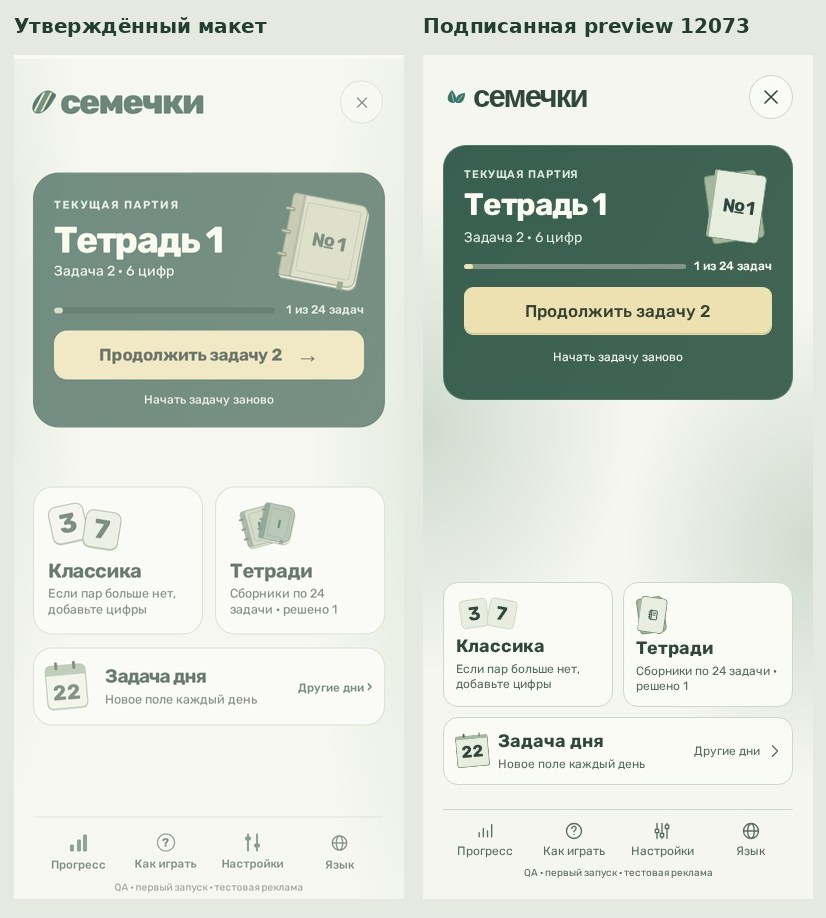

# «Семечки» · независимая проверка preview 12073
22 ноября 2026. На первый плейтест сборку передавать можно. В ТЗ редизайна остаётся функциональная ошибка в переходе к тетради. Для следующей сборки приоритет имеют этот переход, текст уроков и компоновка меню. Эффект для понимания и удержания предстоит измерить на игроках.

Проверена рабочая [PR №9](https://github.com/DanilaH/seeds-bits/pull/9) на ревизии `0a4d2842372f19c1a5625769175a463927642376`. Игровой код соответствует `bacf41ffaebaf2100754111bf731cf68bb960404`. [ТЗ и 14 согласованных кадров](../../design/calm-screens-2026-11-22/README.md) попали в рабочую ветку через [PR №10](https://github.com/DanilaH/seeds-bits/pull/10). На момент аудита main игры был на `4f7a8f9`, ветки RuStore и NashStore на `746277f` и `7537d9c`. Выводы относятся к preview.

## Что поправить и как принять

| Приоритет и режим | Сценарий и наблюдение в preview | Изменение и приёмка |
|---|---|---|
| **1. Прогресс → Тетради** | Решить первую задачу, сделать ход во второй. В «Тетради → Другие тетради» выбрать «Не начаты», вернуться через меню в «Прогресс» и нажать «Тетрадь 1 · 1 из 24». Открывается **тетрадь 2**. Её основная кнопка фактически запускает `book-v1-25`. С фильтром «Пройдены» карточка ведёт в пустой список. | При адресном входе открыть именно том с нажатой карточки. Если фильтр мешает, снять его для этого входа. В обоих сценариях видны «Тетрадь 1», 1/24 и продолжение задачи 2. Нажатие возвращает сохранённое поле задачи 2 с работающей отменой. Обычная ручная фильтрация каталога работает как прежде. [Карточка и выбор кандидатов](../../../src/main.ts#L3540) · [Обработчик](../../../src/main.ts#L3749) · [Два экрана одного прохода](notebook.jpg) |
| **2. «Как играть»** | В уроке 1 команда «Нажмите на две четвёрки» дана дважды. В уроке 3 сверху «Соедините две двойки», ниже «Пустые клетки не мешают. Соедините две двойки», затем ещё «Попробуйте на маленьком поле». В утверждённом кадре игроку достаточно одной команды и правила. | Вывести шаг, одну команду и одно правило. Для урока 3 достаточно «Соедините две двойки» и «Пустые клетки между ними можно пропускать». После пары показать подтверждение и «Дальше» в отведённом месте. Проверить все шесть уроков, короткий курс и длинные переводы. При смене команды верх поля меняется максимум на 1 CSS px. [Сборка текста](../../../src/main.ts#L2229) · [Кадр 13](../../design/calm-screens-2026-11-22/frames/13-lesson.jpg) · [Снимок игры](lesson-and-trophy.jpg) |
| **3. Меню паузы** | Та же партия, 390×844, без баннера. Карточка задачи 2 заканчивается на y=345, «Классика / Тетради» начинаются на y=527. Пустой промежуток 182 CSS px, на согласованном кадре около 60. С учётом QA-подписи до нижнего края осталось 20 px. | Сохранить нижний край, высвободить место для карточек режимов и перераспределить промежутки между группами. На том же состоянии предъявить кадр рядом с макетом. Ориентир для промежутка 50–70 px при 390×844. На 320×568 с баннером последний пункт должен достигаться прокруткой. [Стили](../../../src/calm-screens.css#L96) · [Сравнение меню](menu.jpg) |
| **4. Задача из архива** | Через выбор года открыть 13 ноября 2025 и 13 ноября 2026. У задач разные ID и поля. Обе на поле называются «Задача из архива · 13 ноября», в паузе обе предлагают «Продолжить задачу за 13 ноября». На результате уже выводится год. | Использовать для дат другого года формат с годом на поле и в карточке продолжения. Проверить обе даты, выход и перезапуск. Игрок должен различить задачу до нажатия, выбор должен сохранить её ID. На пяти языках дата помещается в строку или переносится в отведённой зоне. [Заголовок поля](../../../src/main.ts#L543) · [Пауза](../../../src/main.ts#L3938) |
| **5. Трофеи месяца и результат дня** | При 0/7 в коллекции уже видна крупная бронзовая медаль с цветными лентами. На результате дня при 1/7 подпись «Бронза», а число «ещё» рядом относится к серебру. В кадре 10 ближайшая цель формулируется «До бронзы — 7 дней». Начисление лишней медали в этих проверках не наблюдалось. | Сделать целью именно ближайшую степень, до достижения показывать приглушённый знак и число оставшихся дней. Проверить состояния 0, 6, 7, 13, 14 и последний день месяца. При 0/7 должно быть ясно, что медаль ещё предстоит получить. [Отрисовка](../../../src/trophies.ts#L16) · [Кадр 10](../../design/calm-screens-2026-11-22/frames/10-trophies.jpg) · [Снимок игры](lesson-and-trophy.jpg) |
| **6. Баночки и русский текст** | После первой победы расчёт верный, 4/24. Внутри банки видна сплошная полоса. В утверждённом кадре те же 4 семечка можно узнать по силуэту. Строка коллекции реально показывает «0 собрано · 4 семечек». | Дать наполнению различимую фактуру семечек в общем рисунке банки и отделить подпись количества собранных банок. Согласовать слово при 1, 2, 4, 5, 11 и 21 либо поставить самостоятельную метку «Семечки» рядом с числом. Значения результата, прогресса и коллекции совпадают. [Банка](../../../src/main.ts#L3878) · [Строка](../../../src/i18n/ui-copy.json#L1122) · [Кадр 09](../../design/calm-screens-2026-11-22/frames/09-jars.jpg) |

**Меню на одном размере экрана.** Слева утверждённый кадр, справа фактическая игровая часть APK. В обоих случаях решена задача 1 и сделан один ход в задаче 2.

## Что удалось повторить

| Кадры и режим | Результат независимого прогона |
|---|---|
| 00 · пауза | Видны текущая тетрадь, задача 2, 6 цифр и 1/24. «Продолжить» возвращает в сохранённое поле. Перезапуск просит подтверждения. Раскладка отличается от макета. |
| 01 · первая задача | На чистом профиле пройдены пары 8–17, 4–5, 9–11 и 7–14 (индексы с нуля). Проверены оба порядка последней пары. При выборе, объяснении пустоты, переходе через край и явной подсказке верх сетки стоит на месте. Центры оставшихся цифр доступны для нажатия. |
| 02 · первая победа | Фактически показаны +4, банка 4/24, тетрадь 1/24 и «К задаче 2». После хода и перезапуска восстановился тот же массив поля. Пройдены тесты повторного начисления, ошибки сохранения и раннего перехода во время эффекта. |
| 03 · тетради | Раскрываются каталог и дополнительные страницы, работают ручной выбор тома и запуск задачи. В контрольных сохранениях завершение задач 6 и 24 предлагает задачу 7 и первую задачу тома 2. Адресный вход из «Прогресса» требует исправления. |
| 04 · классика | На сохранённом поле без доступной пары «Добавить» увеличило число цифр с 9 до 18, «Отмена» вернула исходное поле. Проверены победа и предложение перейти в тетрадь. Для блокировок по горизонтали, вертикали, обеим диагоналям и через край тесты подтвердили подсветку всех препятствий на выбранном пути и её очистку. |
| 05–07 · календарь, архив, результат дня | «Задача дня» и «Другие дни» ведут в своё место. Открылись исторический месяц, февраль 2025 с 28 днями и выбранная дата. Завтрашняя ячейка недоступна. На сохранении с двумя пятёрками победа за 22.11.2026 показала 1 пару, 0 подсказок, 1/30 и переход на 21 ноября. Проверен возврат к архивной партии после перезапуска. Остаётся неоднозначность года. |
| 08–10 · прогресс, банки и трофеи | Один выигрыш дал согласованные значения 1/24 задачи и 4/24 семечка. Из трофеев открываются календарь выбранного месяца и возврат в коллекцию. Проблемы перехода к тетради, оформления цели и строки коллекции описаны выше. |
| 11–12 · настройки и языки | Открыты настройки, конфиденциальность и выбор языка. Переключены RU, EN, ES, TR, PT-BR и автоматический режим на русском и английском профилях. Сохранённые игровые данные проверены на маршруте возвращения. У экрана языка ещё одно визуальное отличие от кадра 12 — тёмные прямоугольные рамки у каждой строки. Это косметическая правка после функциональных. |
| 13 · «Как играть» | Пройдены все шесть упражнений, включая диагональ, переход через строку и отмену добавления. Замерены выбор, ответ и появление «Дальше». Верх области поля остаётся на y=248 в RU 390×844 и y=207 в PT-BR/TR 320×568. На последнем шаге высота области меняется под действия, верх остаётся на месте. Дублирование инструкции сохранилось. |

## Граница доказательств

- **APK.** `com.seedsbits.game.preview`, 1.1.2, versionCode 12073, 5 755 603 байта. SHA256 **e065c6750a13de20853d32a7ce1176f1e9f0d43dca342e1e9a951e22cdb68997**. Сертификат SHA256 `ee910b7ef7ed79fe27f15c26f8b70324133ac77c87d137a09c492e7b2bb7de30`. Подписи v2/v3 проверены у самого файла. [Паспорт сборки](../../STATUS.md)
- **Собственный прогон.** Из подписанного APK извлечены файлы `assets/public`. Логика, навигация и JPEG проверены в Chromium 141.0.7390.37 на этих файлах. Основная партия начата с чистого профиля. Для редких исходов классики, окончания тома и задачи дня заданы контрольные сохранения. Проверены RU 390×844 и четыре остальных языка при 320×568. Отдельно проверен шестишаговый курс на трёх сочетаниях размера и языка с моделированием резерва под баннер 50 px. В исходниках прошли 122 модульных теста и сборка. На файлах APK прошли 31 браузерный тест обратной связи и ещё 6 тестов первой партии, архива и результата. [Выдержка измерений](evidence.json) · [Тесты путей](../../../e2e/pair-feedback.spec.ts) · [Первая партия](../../../e2e/first-session.spec.ts) · [Результат](../../../e2e/result-feedback.spec.ts)
- **Свидетельство разработчика.** В [Android CI](https://github.com/DanilaH/seeds-bits/actions/runs/45052405261) использовались API 35 и WebView 124. Отдельный [диагностический прогон](https://github.com/DanilaH/seeds-bits/actions/runs/45051338930) включал 566 состояний и системный шрифт 100/150/200%. [Отчёт с границами проверки и эпизодом победы](../first-session-2026-11-20/implementation/CALM_SCREENS_12073_FINAL.md)
- **Физический телефон и аудитория — UNKNOWN.** На точном подписанном APK проверить обновление 12072 → 12073, Android Back, TalkBack, отклик звука и вибрации, возобновление в авиарежиме. На новом игроке без подсказок ведущего записать первый самостоятельный переход через пустоту или край, объяснение «1 из 24», первое нажатие для задачи 2 и возврат из задачи дня в свою тетрадь. Данных о влиянии на удержание пока нет.
- **Предел продуктовых выводов.** Боевые показы рекламы, покупки, реальные атрибуции установок и доставка аналитики требуют store/portal-сборки с соответствующим SDK и проверки в кабинете. Preview с тестовой рекламой не подтверждает эти результаты. Изменение экономики, выдачи, вероятности тупиков, событий и турниров этим сравнением экранов не установлено. Пауза экспериментов остаётся решением владельца. [Решения](../../PROJECT_DECISIONS.md) · [Пауза помощи](../../help-pause-2026-11-13.md)
- **KIT IMPACT · REUSE.** Для других игр применима проверка адресного перехода после смены фильтра списка и измерение геометрии на одном игровом состоянии. Новых наблюдений оригиналов Easybrain или NADO в этой проверке нет. Статусы их механик в [реестре](../../porting/ADOPTION_LEDGER.json) сохраняют прежний уровень доказательств. [Индекс исследования в ките](https://github.com/DanilaH/mini-games-kit/blob/5cac32b0851c80bdff1d61069b8524b9e42170e1/research/games/seeds/README.md)
