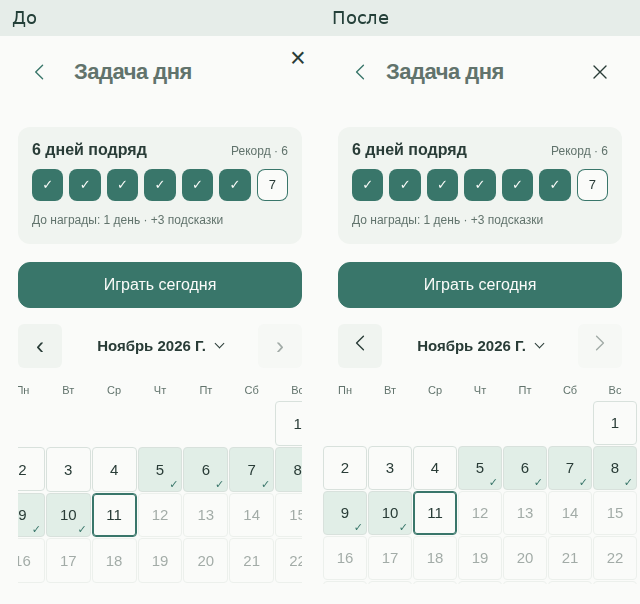
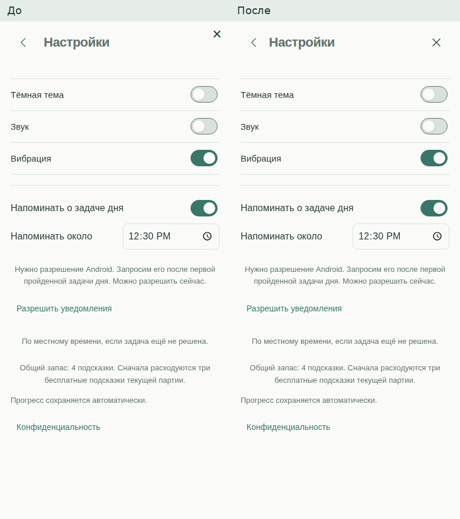
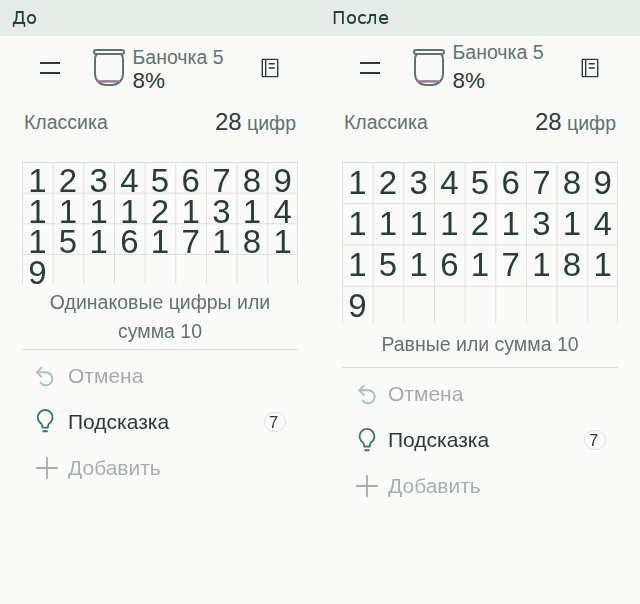
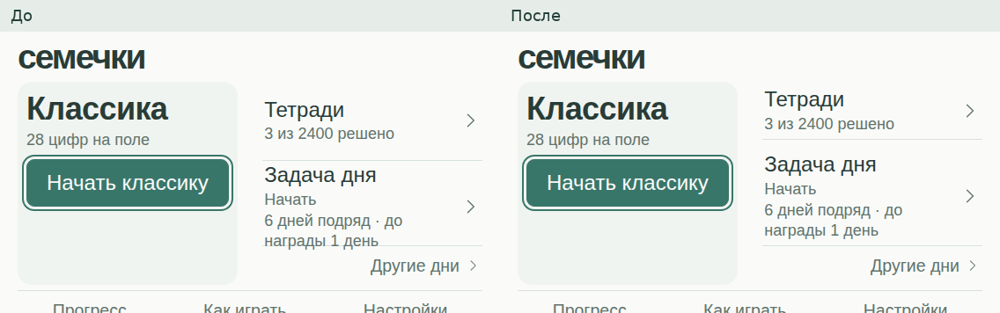
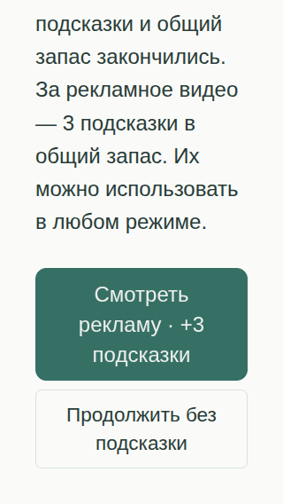
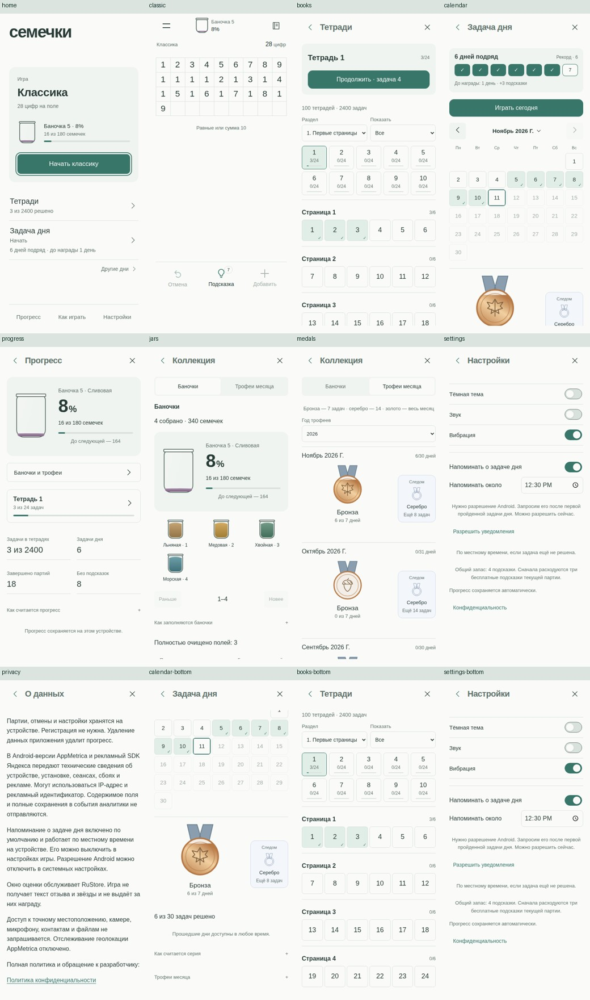

# Визуальная приёмка, 11.11.2026

До: runtime `90353c7`, съёмка `524c1d2`, run [43077392500](https://github.com/DanilaH/seeds-bits/actions/runs/43077392500).
После: runtime и съёмка `4ecb9fc`, run [43086366329](https://github.com/DanilaH/seeds-bits/actions/runs/43086366329), artifact `13886088162`.

Это реальные снимки браузера с подготовленными состояниями и тестовыми ответами рекламного моста. Сравнения соединяют два исходных кадра, без дорисовки интерфейса. Полный архив из 394 снимков доступен в указанном запуске CI.

## Календарь 320 px

## Шапка и иконка закрытия

## Цифры при 150% текста

## Короткое горизонтальное меню при 150% текста

## Подсказки при 150% текста

Нижняя часть окна после прокрутки: обе кнопки целиком, текст внутри их границ.

## Обзор обычных экранов

[Подробный отчёт](../VISUAL_RECHECK_2026-11-11.md). Физический Android, реальные рекламные креативы и системное масштабирование в эту браузерную съёмку не входят. Ранее выданный APK 1102015 этих изменений не содержит.
